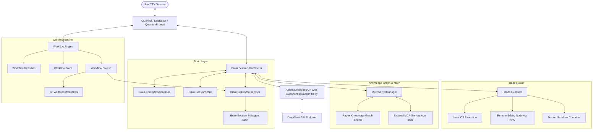

# Yoke (Yoke) — Architecture & Design

Yoke is an autonomous, agentic CLI coding framework written in Elixir on Erlang/OTP. It pairs powerful LLM reasoning (DeepSeek-V3 and DeepSeek-R1) with BEAM actor concurrency, hot-code reloading, distributed execution, and spatiotemporal state checkpoints.

---

## High-Level Architecture Diagram

---

## Core Components

### 1. Brain Layer (`lib/yoke/brain/`)
- **`Session` (`GenServer`)**: Manages conversation context state, model selection, permission authorization gates, temporal state snapshots, and turn execution loops.
- **`SessionSupervisor` (`DynamicSupervisor`)**: Dynamically spawns and monitors interactive user sessions and subagent worker actors.
- **`ContextCompressor`**: Summarizes long context histories when token limits or `/compact` commands are triggered.

### 2. Hands Layer (`lib/yoke/hands/`)
- **`Executor`**: Dispatches tool calls across execution targets (`:local`, `:remote` Erlang nodes, `:docker` container sandboxes). Enforces workspace sandbox bounds when `/sandbox` is enabled.

### 3. Knowledge Graph & MCP (`lib/yoke/mcp/`)
- **`ServerManager`**: First-class supervisor for the `Ragex` code intelligence engine and external Model Context Protocol (MCP) servers over stdio JSON-RPC. Automatically builds dynamic Elixir tool modules for live hot-code tool access.

### 4. Client Layer (`lib/yoke/client/`)
- **`DeepSeekAPI`**: Handles REST communications with `deepseek-chat` (V3) and `deepseek-reasoner` (R1) API endpoints with automatic exponential backoff retry for transient network and rate-limit HTTP errors. Deterministic failures (HTTP 401, 403, and other 4xx responses) are not retried; they surface immediately with a message naming the cause, because repeating the same rejected request cannot succeed.

### 5. CLI & TUI Layer (`lib/yoke/cli/`)
- **`LineEditor`**: Fixed bottom command bar TUI with horizontal ruler, grapheme-aware Unicode cursor navigation, and persistent history.
- **`QuestionPrompt`**: In-place interactive terminal modal for single-choice and multi-choice questions with multi-line text wrapping and pixel-perfect border alignment.

### 6. Workflow Engine (`lib/yoke/workflow/`)
- **`Definition`**: Parses/validates customizable, JSON-defined multi-step workflows; two-tier discovery (workspace + global) plus bundled defaults (`elixir`), materialized on first use.
- **`Store`**: Disk persistence for workflow runs under `.yoke/workflows/runs/<id>/` -- resumable `state.json` checkpoint plus an append-only `transcript.jsonl` of every prompt, response, confirmation, and command.
- **`Engine`**: Drives step execution/resume; a plain module (not a `GenServer`) that blocks the caller synchronously like a regular agent turn, delegating genuine parallelism to real `Brain.Session` processes for accepted subtasks.
- **`Steps.*`**: One module per step type (`Branch`, `TaskDescription`, `TaskSplit`, `TestsAndDocs`, `Lint`, `Commit`, `Prompt`) behind a common `Workflow.Step` behaviour. `TaskSplit` isolates parallel subtasks in their own `git worktree` so concurrent agents can never clash on disk. See [`docs/WORKFLOW_ENGINE.md`](WORKFLOW_ENGINE.md) for the full reference.
